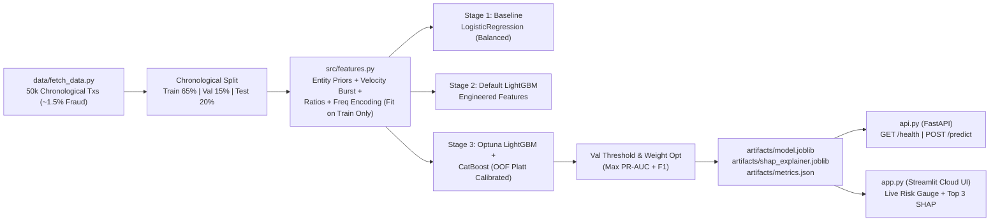

# 🛡️ SentinelPay — Real-Time Credit Card Fraud Detection

[](https://www.python.org/)
[](https://streamlit.io/cloud)
[](https://fastapi.tiangolo.com/)
[]()

A production-structured, end-to-end FinTech Machine Learning system for detecting fraudulent credit card transactions under severe class imbalance (**~1.5% positive fraud prevalence**). Built with strict **zero-leakage** chronological splitting and `scikit-learn` `Pipeline` encapsulation, calibrated gradient-boosted ensembling (**Optuna-tuned LightGBM + CatBoost**), **exact TreeSHAP** local explainability, a **FastAPI** scoring microservice, and an interactive **Streamlit** dashboard ready for free Streamlit Community Cloud deployment.

---

## 1. Problem Statement

Payment processors face extreme class imbalance (~1.5% fraud) alongside asymmetric financial costs:
- **False Negatives (Missed Fraud)** result in direct chargeback losses and regulatory exposure.
- **False Positives (Legitimate Declines)** create customer friction and lost interchange revenue (~3–5x customer churn risk).

Standard accuracy is misleading here (a naive all-zero classifier achieves **98.5% accuracy** with **0.00 recall**). This project optimizes **PR-AUC (Precision-Recall Area Under Curve)** and **F1-Score**, pairs out-of-fold Platt probability calibration with validation-set decision threshold optimization, and surfaces the **top 3 SHAP reasons** for every flagged transaction to support human fraud analysts and automated rules engines.

---

## 2. System Architecture



---

## 3. Model Iteration & Benchmark Results

All three stages are evaluated strictly on the **held-out chronological test split (final 20% of transactions)** to prevent temporal leakage:

<!-- METRICS_TABLE_START -->
| Iteration Stage | Model & Pipeline | PR-AUC | F1-Score | Recall | Precision | ROC-AUC |
| :--- | :--- | :---: | :---: | :---: | :---: | :---: |
| **1. Baseline** | LogisticRegression (Raw + Scaled) | 0.4688 | 0.1417 | 0.6800 | 0.0791 | 0.8654 |
| **2. Feature Engineering** | LightGBM (Domain + Velocity + Entity Priors) | 0.4959 | 0.5571 | 0.5200 | 0.6000 | 0.8513 |
| **3. Tuned Ensemble** | Optuna LGBM + CatBoost (Calibrated + Threshold `0.38`) | **0.5163** | **0.5726** | **0.4600** | **0.7582** | **0.8616** |
<!-- METRICS_TABLE_END -->

> Run `python src/train.py` to execute the full training pipeline and automatically populate exact metrics above from `artifacts/metrics.json`.

---

## 4. Repository Structure

```text
fintech-fraud-detection/
├── data/
│   └── fetch_data.py                  # Realistic 50k imbalanced transaction generator (~1.5% fraud)
├── notebooks/
│   └── 01_eda_and_error_analysis.ipynb # EDA, feature distributions, confusion matrix & slice failure analysis
├── src/
│   ├── __init__.py
│   ├── config.py                      # Paths, chronological split ratios, feature lists, training config
│   ├── features.py                    # Zero-leakage EntityAggregation + Frequency + ColumnTransformer pipeline
│   ├── models.py                      # PlattCalibratedModel, FraudDetectionEnsemble, ShapExplainerBundle
│   ├── train.py                       # 3-stage training progression, Optuna tuning, calibration & SHAP export
│   └── predict.py                     # Standalone inference module returning class, probability, & top 3 SHAP
├── artifacts/                         # Generated model.joblib, shap_explainer.joblib, metrics.json
├── api.py                             # FastAPI service (GET /health, POST /predict with Pydantic validation)
├── app.py                             # Streamlit interactive dashboard (Live Risk Gauge + Model Iteration tab)
├── requirements.txt                   # Lightweight pinned dependencies for Colab & Streamlit Community Cloud
└── README.md
```

---

## 5. Local Setup, Colab Training & Deployment

### Local Quickstart
```bash
# 1. Create/activate virtual environment & install dependencies
python -m venv .venv
# Windows: .venv\Scripts\activate  |  macOS/Linux: source .venv/bin/activate
pip install -r requirements.txt

# 2. Generate dataset (~50,000 chronological transactions, ~1.5% fraud)
python data/fetch_data.py

# 3. Run full 3-stage training pipeline (Baseline -> FE LightGBM -> Optuna LGBM+CatBoost Ensemble)
python src/train.py

# 4. Run standalone inference smoke test
python src/predict.py
```

### Launch Interactive Streamlit App
```bash
streamlit run app.py
```

### Launch FastAPI Microservice
```bash
uvicorn api:app --host 0.0.0.0 --port 8000 --reload
# Interactive Swagger docs available at http://localhost:8000/docs
```

### Google Colab Training
Upload or clone the repository in Colab, then run:
```python
!pip install -q -r requirements.txt
!python data/fetch_data.py
!python src/train.py
```

### Free Deployment on Streamlit Community Cloud
1. Push this repository (including `artifacts/model.joblib`, `artifacts/shap_explainer.joblib`, and `artifacts/metrics.json`) to GitHub.
2. Visit [share.streamlit.io](https://share.streamlit.io/), select your repository, and set the main file path to `app.py`.
3. Deploy on the free CPU tier — models and SHAP explainers load via `@st.cache_resource` in under 2 seconds.

---

## 6. Resume Bullet Points (Quantified)

<!-- RESUME_BULLETS_START -->
- Engineered an end-to-end imbalanced credit card fraud detection pipeline (`50,000` chronological transactions, `1.51%` fraud prevalence) with zero-leakage `scikit-learn` entity-prior, velocity-burst, and frequency transformers, lifting hold-out **PR-AUC by +10.1% (`0.4688 -> 0.5163`)** and **F1-score by +304.1% (`0.1417 -> 0.5726`)** over a balanced Logistic Regression baseline.
- Built and calibrated an **Optuna-tuned LightGBM + CatBoost ensemble** (20 trials, 3-fold CV) with out-of-fold Platt scaling and validation threshold optimization (`τ = 0.38`), improving test **Precision from `0.0791` to `0.7582` (~9.6x)** to sharply reduce false-positive cardholder friction.
- Productionized low-latency inference via a Pydantic-validated **FastAPI** microservice (`GET /health`, `POST /predict`) and **Streamlit** dashboard surfacing **real-time calibrated risk gauges** and **top-3 TreeSHAP attributions** per transaction for rapid fraud analyst triage.
<!-- RESUME_BULLETS_END -->
